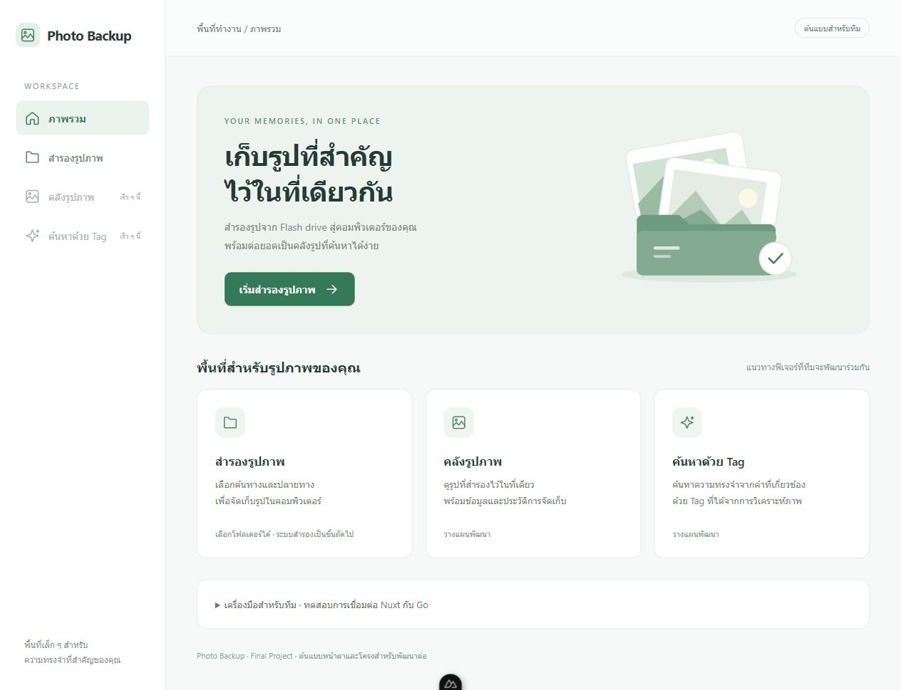

# Photo Backup — Final Crossplatform

Desktop app สำหรับสำรองรูปจาก Flash drive พัฒนาด้วย Go + Wails v2 และ Nuxt โดยกลุ่ม 3 คน เป้าหมายถัดไปคือ SQLite/GORM, คลังรูปภาพ และการค้นหาด้วย Tag จากการวิเคราะห์ภาพ

## สถานะปัจจุบัน

อัปเดตวันที่ 16 ตุลาคม 2026

ส่วนที่ 1 คัดลอกรูปลงเครื่องพร้อมใช้งานในโค้ดแล้ว: รวมโฟลเดอร์ย่อย เก็บต้นฉบับ ข้ามชื่อซ้ำ แสดงความคืบหน้าและผลรายไฟล์ ดู [คู่มือส่วนคัดลอกและจุดเชื่อมสำหรับฐานข้อมูล](docs/COPY_BACKUP.md)

| ส่วนของโปรแกรม | สถานะ |
| --- | --- |
| Wails + Nuxt | เปิดแอปและเรียก Go ผ่าน Wails binding ได้ |
| หน้าเว็บ | หน้าภาพรวมและหน้าสำรองรูป โทนขาว–เขียวอ่อน แยก pages/components |
| เลือกโฟลเดอร์ | มี SelectSource / SelectDestination เปิดหน้าต่างเลือกต้นทางและปลายทางผ่าน Go; ยกเลิกแล้วคงค่าเดิม |
| สำรองไฟล์ | คัดลอกรูปรวมโฟลเดอร์ย่อย ข้ามชื่อซ้ำ แสดงความคืบหน้าและผลรายไฟล์ |
| SQLite/GORM และประวัติ | ยังไม่ได้พัฒนา |
| คลังรูปภาพ / วิเคราะห์ภาพ / Tag Cloud / ค้นหา | ยังไม่ได้พัฒนา เมนูระบุว่าเร็ว ๆ นี้ |
| macOS | มีแนวทางตั้งค่าตามบทเรียน แต่ยังไม่ได้ทดสอบบนเครื่องจริง |



[ดูภาพหน้าสำรองรูป](docs/previews/backup.jpg) — ภาพต้นแบบสำหรับคุยกับทีม ยังไม่ใช่ระบบ Backup ที่ทำงานครบ

## เครื่องมือที่ต้องติดตั้ง

- Go 1.25 ขึ้นไปตาม go.mod (เครื่องเริ่มต้นใช้ 1.26.4)
- Node.js 24 LTS และ npm (เครื่องเริ่มต้นใช้ 24.18.0)
- Wails CLI v2.13.0
- Windows: WebView2; macOS: Xcode Command Line Tools ตาม [Wails installation](https://v2.wails.io/docs/gettingstarted/installation/)
- dependency ranges ตามบทเรียน: Nuxt ^4.4.7, Vue ^3.5.35, Vue Router ^5.1.0; lockfile ปัจจุบันใช้ 4.6.1 / 3.5.43 / 5.1.0

## เปิดแอปเพื่อพัฒนา

```sh
git clone https://github.com/podo4455/Final-Crossplatform.git
cd Final-Crossplatform
wails doctor
cd frontend
npm ci
cd ..
go mod download
wails dev
```

หาก clone ไว้แล้ว ให้เริ่มคำสั่งจาก root ของ repository หลังอัปเดตโค้ด

- หน้าแรก: กด “เริ่มสำรองรูปภาพ” เพื่อไปหน้าเลือกโฟลเดอร์
- หน้า Backup: เลือกต้นทางและปลายทางในหน้าต่าง Wails แล้วเริ่มคัดลอกได้ เก็บต้นฉบับไว้และไม่เขียนทับไฟล์เดิม
- ทดสอบ Go: เปิดส่วน “เครื่องมือสำหรับทีม” ที่หน้าแรก แล้วกดทดสอบการเชื่อมต่อ

สำหรับ macOS ให้ปรับ script `dev` ใน frontend/package.json เป็น `TMPDIR=/tmp nuxt dev` ตามบทเรียนก่อนรัน `wails dev` (มี `dev:mac` เก็บไว้สำหรับเรียก Nuxt โดยตรง)

### ดูเฉพาะหน้าตาใน browser

```sh
cd frontend
npm run dev
```

เปิด URL ที่ Nuxt แสดง เช่น http://localhost:3000/#/ แล้วใช้เมนูเปลี่ยนหน้าได้ การเลือกโฟลเดอร์และเรียก Go ต้องเปิดผ่าน Wails; browser ธรรมดาจะแสดงข้อความแจ้งเมื่อกดปุ่มเหล่านี้

## Build

รันจาก root:

```sh
wails build
```

ไฟล์แอปอยู่ใน `build/bin/` ของ OS ที่ build ต้องทดสอบและ build macOS บนเครื่องที่รองรับแยกจาก Windows

`frontend/dist/.gitkeep` เก็บไว้เพื่อให้ Go embed มีไฟล์บน clone ใหม่ ส่วนไฟล์เว็บจริงสร้างด้วย `npm run generate` และไม่ commit หาก generate ล้าง .gitkeep ให้สร้างไฟล์นี้กลับก่อน commit

## โครงสร้างไฟล์

| ไฟล์ / โฟลเดอร์ | หน้าที่ |
| --- | --- |
| main.go | เปิดหน้าต่าง Wails, embed frontend และ bind App |
| app.go | เก็บ context และเมธอด Go: Greet, SelectSource, SelectDestination |
| wails.json | คำสั่ง install / generate / dev และชื่อแอป |
| frontend/nuxt.config.ts | SPA, hash router, HMR และ output ตามบทเรียน |
| frontend/app/app.vue | ครอบทุกหน้าด้วย AppShell และแสดง NuxtPage |
| frontend/app/pages/index.vue | หน้าภาพรวมและส่วนทดสอบการเชื่อมต่อ Go |
| frontend/app/pages/backup.vue | หน้าเลือกโฟลเดอร์และจัดการผลจาก Go |
| frontend/app/components/AppShell.vue | เมนูและกรอบหน้าหลักที่ใช้ร่วมกัน |
| frontend/app/components/FolderSelector.vue | ช่องแสดง path และปุ่มเลือกโฟลเดอร์ |
| frontend/app/components/AppIcon.vue | ไอคอน SVG ที่ใช้ร่วมกัน |
| frontend/app/components/PhotoIllustration.vue | ภาพประกอบ SVG หน้าแรก |
| frontend/app/assets/css/main.css | สี ระยะห่าง และการจัดหน้าตามขนาดจอ |
| frontend/wailsjs/ | bindings ที่ Wails สร้าง ไม่แก้ด้วยมือ |
| docs/previews/ | ภาพหน้าจอสำหรับคุยกับทีม |

Nuxt config และคำสั่ง Wails ยึด `05-Wails Application/01-Initial Wails Project.md` ของรายวิชา ส่วนหน้าตา components, CSS, ชื่อแอป และ .gitkeep เป็นส่วนที่เพิ่มสำหรับโปรเจกต์กลุ่ม ไม่มี wrapper script สำหรับ dev แล้ว

## ทำงานร่วมกัน

- [แผนแบ่งงาน 3 คน](docs/TEAM_PLAN.md)
- [รายการงานสำหรับสร้าง Issue](docs/ISSUE_BACKLOG.md)
- [คู่มือ GitHub และเริ่มงานของเพื่อน](docs/GETTING_STARTED.md)
- [บันทึกการตรวจสอบ](docs/SETUP_VERIFICATION.md)

ขั้นถัดไป: ใช้ผลลัพธ์ `service.Result` จากส่วนคัดลอกเป็นจุดเชื่อมให้ B ทำ SQLite/GORM และคลังรูป และ C วิเคราะห์ภาพและ Tag ส่วน A ทดสอบกับอุปกรณ์จริงบน Windows/macOS ต่อ โดยแยก branch ต่อ Issue และให้เพื่อน review PR

Commit source และ lockfiles; ไม่ commit build/bin, node_modules, ฐานข้อมูล, key หรือรูปส่วนตัว ภาพใน docs/previews เป็นภาพ UI ของต้นแบบ

## Dependency audit

ผลตรวจเดิมวันที่ 10 ตุลาคม 2026: npm audit รายงาน 14 รายการ (7 high, 7 critical รวม dependencies ที่ส่งผลต่อกัน) ใน Nuxt/toolchain เช่น simple-git, node-forge และ braces ยังไม่ได้ตรวจ audit ใหม่ในการปรับ UI ครั้งนี้ และไม่ได้ใช้ npm audit fix --force เพราะเสนอการเปลี่ยน Nuxt ข้าม major ควรติดตามแพตช์ก่อนส่งงานจริง
